# DCS Host Simulator 日本語マニュアル

対象: DCS Host Simulator 2.0.6.1(The Vision Council)

このマニュアルは、プログラムの画面・設定ファイル・サンプルジョブを調べて書いたものです。公式の説明書ではありません。
動かして確かめていないところは「(推測)」と書いています。

画面の画像は、インストールしたときのままの設定で撮りました。この状態では COM ポートが決まっていないので、ポートは開かず、通信の設定の **COM Port** は空欄になります(5 章の注意を参照)。

## 目次

1. [このソフトでできること](#1-このソフトでできること)
2. [ファイルの構成](#2-ファイルの構成)
3. [使い方の手順](#3-使い方の手順)
4. [画面ごとの項目(英日対照)](#4-画面ごとの項目英日対照)
5. [DCS.INI の設定](#5-dcsini-の設定)
6. [そのほかの設定ファイル](#6-そのほかの設定ファイル)
7. [サンプルジョブ](#7-サンプルジョブ)
8. [ログによく出る言葉](#8-ログによく出る言葉)
9. [入手について](#9-入手について)

---

## 1. このソフトでできること

眼鏡の加工所では、ホスト(ラボの管理ソフト)と装置(トレーサー・エッジャー・ブロッカーなど)が、DCS(Data Communication Standard)という決まりでデータをやりとりします。
このソフトは**ホストの役**をします。装置を 1 台つなぐと、次のことを試せます。

- 装置の初期化(`REQ=INI`)に答える
- 装置がジョブ番号を指定して、加工データを取りに来る(ダウンロード)。ソフトは `Jobs` フォルダのジョブファイルを読んで送る
- 装置が測った玉形などを送ってくる(アップロード)。ソフトはそれをジョブファイルに保存する
- やりとりの中身をすべてログに残し、受け取った形・送った形を図で見る
- わざと崩した書き方(余分な空白、いろいろな行末記号、意味のない REM 行など)で送り、装置が規格どおりに受け取れるかを試す

対応している規格の版は 3.02 と 3.03 です(設定ファイルの注記による)。

## 2. ファイルの構成

| ファイル | 役割 |
| --- | --- |
| `DCSSim.exe` | 本体 |
| `DCS.INI` | 通信・プロトコル・ログなどの設定。画面で変えた設定もここに保存される。ただし、ファイルの注釈に書かれた節の一部は、変えても効かない様子(→ [5 章](#5-dcsini-の設定)) |
| `VCA_Records.INI` | 規格で決まっているレコードの定義。**変えないこと** |
| `VCA_INI.INI` | 装置の種類ごとに送るレコードの一覧。**変えないこと**(変えると規格に合わなくなる) |
| `UserINI.INI` | 特定の装置向けに、送るレコードの一覧を上書きするファイル |
| `User_Records.INI` | 自分で足すレコードの定義(試作用) |
| `Jobs/` | ジョブファイル。ファイル名がジョブ番号(例: `9001.TXT`) |
| `hist.txt` | 変更履歴(Help → Change Log で表示) |

> **メモ**: `C:\Program Files (x86)` の中で動かすと、設定の保存やアップロードの保存に管理者の権限が要ることがあります(推測)。うまく保存できないときは、フォルダごと別の場所にコピーして、そこで動かしてください。

## 3. 使い方の手順

### 3.1 つなぐ

**シリアル(RS-232C)でつなぐ場合**

1. 装置とパソコンをシリアルケーブルでつなぐ。
2. **Setup → Communication Parameters** を開く。
3. **Serial Communication** を選ぶ。
4. **COM Port**、**Baud Rate**、**Parity**、**Bits**、**Stop Bits** を装置と同じにする(よく使うのは 9600 bps・パリティなし・8 ビット・ストップビット 1)。
5. 装置が DTR・RTS の信号を見る場合は、**DTR State**・**RTS State** を **On** にする(画面の表示と `DCS.INI` の値が逆になっているので、信号線の実際の状態は装置の側でも確かめる。4.2 を参照)。
6. **OK** を押す。設定は `DCS.INI` の `[Settings]` に保存される。ログに「Serial port COM1 opened OK」のように出れば、つながっています。

**TCP/IP(LAN)でつなぐ場合**

1. **Setup → Communication Parameters** で **TCP/IP Communication** を選ぶ。
2. 装置のほうからつないでくる場合:
   - **Remote Port (TCP)** に、待ち受けるポート番号を入れる(初めは 33512。**Default** ボタンで決まった番号に戻る)。
   - 装置が UDP で相手を探す方式なら、**Rendezvous Port (UDP)** も設定する(初めは 33511。こちらも **Default** ボタンがある)。
3. こちらから装置へつなぐ場合: **Local Connection Enabled** に印を付け、**Local Connection Device Addr:Port** に装置の「IP アドレス:ポート」を入れる。
4. **OK** を押す。ログに「Remote Connection - TCP listening on port …」や「Connected to device with IP address …」が出れば準備ができています。

### 3.2 ジョブを用意する(装置へ送るとき)

1. `Jobs` フォルダに `ジョブ番号.TXT` の名前でジョブファイルを置く。中身は DCS の書き方(`ラベル=値` を 1 行ずつ)。サンプルの `9001.TXT` などをコピーして直すのが早い。
2. ジョブファイルは **File → Open** で開いて、ソフトの中で直すこともできる。直したら **File → Save** で保存する。
3. 右眼・左眼のどちらを加工するかを `DO=B`(両眼)・`DO=R`(右)・`DO=L`(左)で書く。書いていない場合は、**Setup → Protocol Options** の「DO record value when unspecified in job file」の値が使われる。

### 3.3 装置とやりとりする

ふつうの流れは次のとおりです。装置の側から始まり、このソフトは答えるだけです。

1. **初期化**(2 段で行う。試験で確かめた流れ)
   1. 装置が `REQ=INI` を送る。ソフトは `ANS=INI`・`STATUS=0` と、待ち時間(`TIMEOUT`)・規格の版(`OMAV`)を返す。
   2. 装置が `ANS=INI` で、装置の種類(`DEV`)・メーカー(`VEN`)・対応する玉形の形式(`TRCFMT`・`ZFMT`)を送る。ほしいレコードの一覧があれば、`DEF=名前`・`D=ラベル;ラベル;…`・`ENDDEF=名前` で送る。
   3. ソフトは、取り決めた `TRCFMT`・`ZFMT` と、`DEF=名前;要求番号` を返す。以後、装置は `REQ=要求番号` でジョブを求める。
   - 装置が一覧を送らない場合や、初期化をしない装置は、`REQ=EDG` のように装置の種類で求める。このときは `VCA_INI.INI`・`UserINI.INI` にある装置の種類ごとの一覧(プリセット)が使われる。
2. **ダウンロード**: 装置が `JOB=ジョブ番号` を付けて加工データを求める。ソフトは `Jobs` のファイルを読み、決まったレコードと玉形(`TRCFMT`・`R=` など)を送る。初期化で取り決めた点の数がジョブと違うときは、点の数を変換して送る(800 点から 400 点への変換は、2 点おきに取り出したものと一致した)。
3. **アップロード**: トレーサーなどが、まず `REQ=TRC`・`JOB=ジョブ番号` を送り、ソフトが `STATUS=0` を返したあと、`ANS=TRC` で玉形などを送る。ソフトは「Upload data stored to file」と出して、`Jobs` にジョブファイルとして保存する。
4. それぞれの送受信のたびに、ACK(受け取った)・NAK(受け取れなかった)が返る。CRC が合わないパケットには NAK を返す。

試して分かった、気をつける動き(くわしくは [留意点の一覧](notes.md)):

- 短いラベル(`AX`・`PRVA`・`PRVM`・`PINB`・`FRNT`)を求めると、名前の後ろが同じレコード(`GAX`・`BPRVA` など)も送られる。プリセットの EDG では `FPINB` が 2 回送られる。
- 試した範囲では、Z データ(`ZFMT`・`Z=`)は送られなかった(別の条件が要るのかもしれない)。
- 中心がずれた玉形のアップロードも、警告なしで受け付けた。

ジョブが見つからないときは「JOB NOT FOUND」、初期化をしていないときは「(RE)INITIALIZATION IS REQUIRED」がログに出ます。

### 3.4 結果を見る

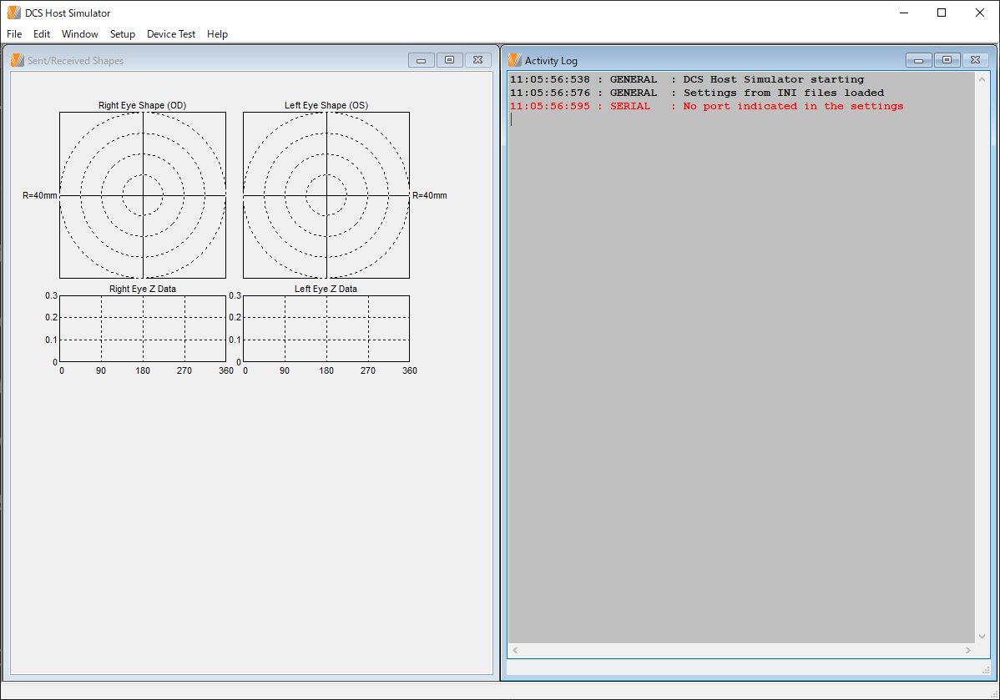

- **Sent/Received Shapes**: 送った玉形・受け取った玉形を図で見る。Z データや穴あけ(ドリル)の位置も描かれる。
- **Activity Log(アクティビティログ)**: 送ったもの・受け取ったもの・警告・エラーが色分けして出る。右クリックで、全部選ぶ・コピー・印刷・消去・ジョブファイルを開く(Edit Job File)ができる。
- ログの量は **Setup → Logging Options**、色と文字は **Setup → Activity Log Color Setup** で変える。

### 3.5 装置を厳しく試す

装置が規格どおりに受け取れるかを試したいときは、**Setup → Protocol Options** で次をオンにします。

- **Terminator Type** を **Random** にする(行末の記号を毎回変える)
- **Send Superfluous Spaces**(ラベルと `=` のあいだに空白を入れる)
- **Send Extra REM Records**(意味のない REM 行を混ぜる)
- **Quote Text/Limited Data** を **Random** にする(文字列を引用符で囲んだり囲まなかったりする)
- **Randomize INI Retrieval Order**(送るレコードの順番を変える)

逆に、まず「つながるか」だけを確かめたいときは、これらをオフにして、行末を **CR LF** に固定すると、問題を切り分けやすくなります。

---

## 4. 画面ごとの項目(英日対照)

### 4.1 メイン画面(DCS Host Simulator)


起動すると、中に **Sent/Received Shapes**(形の図)と **Activity Log**(ログ)の 2 つのウィンドウが開きます。起動した直後は 2 つが重なっているので、上の画像のように左右に並べると見やすくなります。Sent/Received Shapes には、右眼(OD)・左眼(OS)の玉形と、その下に Z データのグラフが出ます。

| File | Edit | Window |
| --- | --- | --- |
| 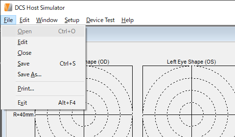 | 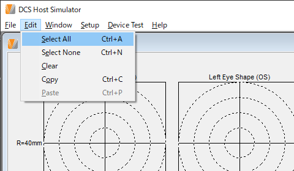 | 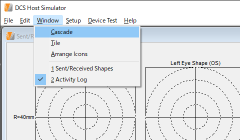 |

| Setup | Device Test | Help |
| --- | --- | --- |
| 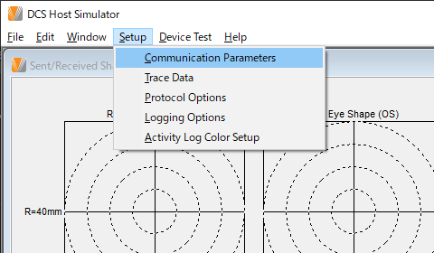 | 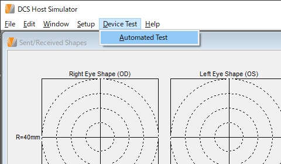 | 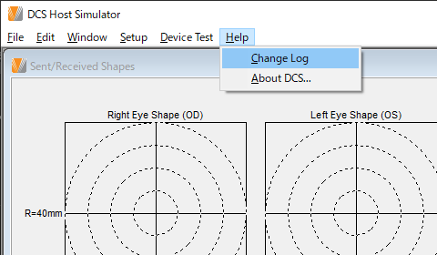 |

| メニュー | 項目 | キー | 意味 |
| --- | --- | --- | --- |
| File(ファイル) | Open | Ctrl+O | ジョブファイルを開く |
| | Edit | | 開いたジョブファイルを編集する |
| | Close | | 閉じる |
| | Save | Ctrl+S | 上書き保存 |
| | Save As... | | 名前を付けて保存 |
| | Print... | | 印刷 |
| | Exit | Alt+F4 | 終了 |
| Edit(編集) | Select All | Ctrl+A | すべて選ぶ |
| | Select None | Ctrl+N | 選ぶのをやめる |
| | Clear | | 消す |
| | Copy | Ctrl+C | コピー |
| | Paste | Ctrl+P | 貼り付け(ふつうの Ctrl+V ではなく Ctrl+P) |
| Window(ウィンドウ) | Cascade | | 重ねて並べる |
| | Tile | | 並べて表示(上下に並ぶ) |
| | Arrange Icons | | アイコンを整列 |
| | 1 Sent/Received Shapes / 2 Activity Log | | 開いているウィンドウに切り替える(印が付いているのが、いま前にあるもの) |
| Setup(設定) | Communication Parameters | | 通信の設定(→ 4.2) |
| | Trace Data | | 玉形データの設定(→ 4.3) |
| | Protocol Options | | プロトコルの設定(→ 4.4) |
| | Logging Options | | ログの設定(→ 4.5) |
| | Activity Log Color Setup | | ログの色の設定(→ 4.6) |
| Device Test(装置の試験) | Automated Test | | 自動試験(中身は未確認) |
| Help(ヘルプ) | Change Log | | 変更履歴(hist.txt)を見る |
| | About DCS... | | バージョン情報 |

- 起動した直後は、**File → Open** と **Edit → Paste** が灰色で選べません。どうすると選べるようになるかは確かめていません。
- ファイルを開く画面(Open Job File)では、Job Files (*.txt)・INI Files (*.ini)・All Files (*.*) を選べます。
- **Window → Tile** は上下に並べます。左右に並べたいときは、2 つのウィンドウの枠を手で動かします(上の画像は左右に並べたもの)。

| システムメニュー | ログの右クリック |
| --- | --- |
| 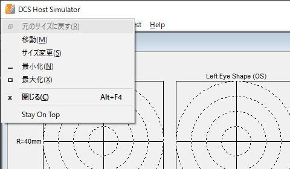 | 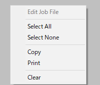 |

- **システムメニュー**(ウィンドウ左上のアイコンをクリック、または Alt+Space): Windows のメニュー(日本語の Windows では日本語で出る)の下に、このソフトが足した **Stay On Top**(いつも手前に表示)があります。
- **ログの右クリック**: Edit Job File(ジョブファイルを編集。起動直後は灰色)・Select All(すべて選ぶ)・Select None(選ぶのをやめる)・Copy(コピー)・Print(印刷)・Clear(消す)。

### 4.2 通信の設定(Communication Parameter Settings)

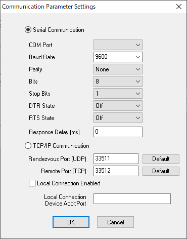

この画面の設定は、`DCS.INI` の `[Settings]` に保存されます(`[COMM_SETUP]` ではありません)。

**DTR・RTS の表示に注意**: `[Settings]` の `DTR=1` は画面で **Off**、`DTR=0` は **On** と表示されます(RTS も同じ)。値が書かれていないときは **Off** と出ます。実際の信号線がどちらになるかは確かめていないので、DTR・RTS を使う装置では、装置の側でも状態を確かめてください。

| 英語 | 日本語 | 選べる値・説明 |
| --- | --- | --- |
| Serial Communication | シリアル通信 | RS-232C でつなぐ |
| TCP/IP Communication | TCP/IP 通信 | LAN でつなぐ |
| COM Port | COM ポート | 使うポート |
| Baud Rate | 通信速度 | 2400 / 9600 / 19200 / 38400 / 57600 / 115200 |
| Parity | パリティ | None(なし)/ Odd(奇数)/ Even(偶数)/ Mark / Space |
| Bits | データビット | 8 / 7 |
| Stop Bits | ストップビット | 1 / 1.5 / 2 |
| DTR State | DTR 信号 | On / Off |
| RTS State | RTS 信号 | On / Off |
| Rendezvous Port (UDP) | 待ち合わせポート(UDP) | 装置からの UDP の呼びかけを待つポート。初めは 33511 |
| Remote Port (TCP) | 待ち受けポート(TCP) | 装置がこのソフトにつなぎに来るポート。初めは 33512 |
| Default | 既定値 | 決まったポート番号を入れる |
| Local Connection Enabled | こちらからつなぐ | 印を付けると、こちらから装置へつなぐ |
| Local Connection Device Addr:Port | つなぐ先の装置 | 装置の「IP アドレス:ポート」 |
| Response Delay (ms) | 応答の遅れ(ミリ秒) | 装置への返事をわざと遅らせる |
| OK / Cancel | 決定 / 取り消し | |

### 4.3 玉形データの設定(Trace Data Setup)

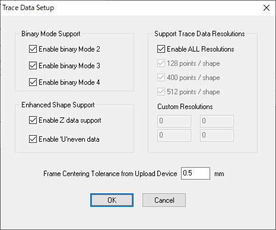

| 英語 | 日本語 | 説明 |
| --- | --- | --- |
| Binary Mode Support | バイナリ形式への対応 | |
| Enable binary Mode 2 / 3 / 4 | バイナリ形式 2 / 3 / 4 を使う | `TRCFMT` の 1 つ目の値。形式 1(文字で書く形式)はいつも使える |
| Enhanced Shape Support | 拡張した形への対応 | |
| Enable Z data support | Z データを使う | 玉形の高さ方向(`ZFMT`・`Z=`) |
| Enable 'U'neven data | 角度が等間隔でないデータを使う | `TRCFMT` の 3 つ目が `U` のもの(角度を `A=` で送る) |
| Support Trace Data Resolutions | 対応する点の数 | |
| Enable ALL Resolutions | すべての点の数を使う | 1〜36000 点。印を付けると下の個別の設定より優先 |
| 128 / 400 / 512 points / shape | 1 周 128 / 400 / 512 点 | 個別に許す点の数 |
| Custom Resolutions | 任意の点の数 | 0 以外の数を入れると、その点の数も許す |
| Frame Centering Tolerance from Upload Device | 装置から受け取った玉形の中心のずれの許容値 | 単位 mm |

### 4.4 プロトコルの設定(Protocol Options)

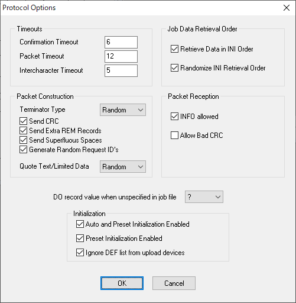

| 英語 | 日本語 | 説明 |
| --- | --- | --- |
| DO record value when unspecified in job file | ジョブに DO がないときの値 | B(両眼)/ R(右)/ L(左)/ N(なし)/ ?(不明) |
| **Timeouts** | **待ち時間** | 単位は秒 |
| Confirmation Timeout | 確認の待ち時間 | 送ってから ACK・NAK が返るまで待つ時間 |
| Packet Timeout | パケットの待ち時間 | パケットとパケットのあいだに待つ時間 |
| Intercharacter Timeout | 文字間の待ち時間 | パケットの中で、文字と文字のあいだに待つ時間 |
| **Packet Construction** | **送るパケットの作り方** | |
| Terminator Type | 行末の記号 | Random(でたらめ)/ CR LF / LF / CR / LF CR / CR CR / LF LF / CR CR CR / LF LF LF / CR LF LF / CR CR LF / LF CR CR / LF LF CR |
| Quote Text/Limited Data | 文字列を引用符で囲む | Never(囲まない)/ Always(いつも)/ Random(でたらめ)/ Alternating(交互) |
| Send CRC | CRC を送る | 誤り検出の値を計算して付ける |
| Send Extra REM Records | 余分な REM を送る | 意味のない注釈行を混ぜる |
| Send Superfluous Spaces | 余分な空白を送る | ラベルと `=` のあいだに空白を入れる |
| Generate Random Request ID's | 要求番号をでたらめにする | 通し番号ではなく、でたらめな番号を使う |
| **Job Data Retrieval Order** | **ジョブのデータを送る順番** | |
| Retrieve Data in INI Order | 一覧の順に送る | 初期化で決まった一覧の順番で送る |
| Randomize INI Retrieval Order | 順番をでたらめにする | 上と一緒に使う |
| **Packet Reception** | **受け取るとき** | |
| Allow Bad CRC | CRC の誤りを許す | 誤りをエラーではなく警告にする |
| INFO allowed | INFO を許す | 装置からの `INFO` レコードを受け付ける |
| **Initialization** | **初期化** | |
| Ignore DEF list from upload devices | アップロード装置の DEF 一覧を無視する | 古い装置に合わせるためのもの。今の規格には合わない |
| Preset Initialization Enabled | プリセット初期化を使う | 装置が一覧を送らないとき、決まった一覧を使う |
| Auto and Preset Initialization Enabled | 自動とプリセットの両方を使う | 印を付けると、上の設定にかかわらずプリセットも使う |

### 4.5 ログの設定(Logging Options)

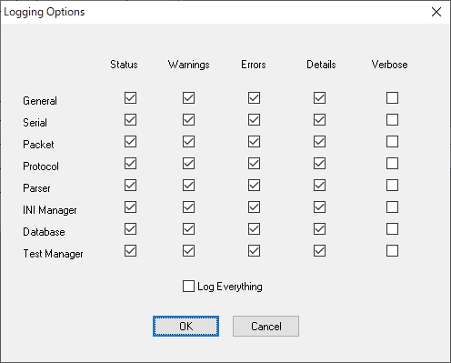

縦に「どの部分のログか」、横に「どのくらい詳しく出すか」が並ぶ表です。

この画面の設定は、`DCS.INI` の `[Logging]` に保存されます(`[LOGGING_SETUP]` ではありません)。列ごとに 1 つの数で、8 つの行(General〜Test Manager)のオン・オフをまとめて表します。すべてオンなら 255 です。インストールしたときは、Status・Warnings・Errors・Details がすべてオン、Verbose がすべてオフです。

| 英語(横) | 日本語 | 説明 |
| --- | --- | --- |
| Status | 状態 | ふつうの経過 |
| Warnings | 警告 | 続けられるが気をつけること |
| Errors | エラー | 続けられないこと |
| Details | 詳細 | もう少し細かい経過 |
| Verbose | すべて | 1 文字ごとなど、とても細かい経過 |

| 英語(縦) | 日本語 | 説明 |
| --- | --- | --- |
| General | 全体 | |
| Serial | シリアル | 通信ポートの出入り |
| Packet | パケット | パケットの組み立てと分解 |
| Protocol | プロトコル | 要求と応答の流れ |
| Parser | 解析 | レコードの読み取り |
| INI Manager | 初期化の管理 | 初期化の一覧 |
| Database | データベース | ジョブファイルの読み書き |
| Test Manager | 試験の管理 | |
| Log Everything | すべて記録する | 印を付けると全部出す(遅くなる) |

### 4.6 ログの色の設定(Activity Log Color Setup)

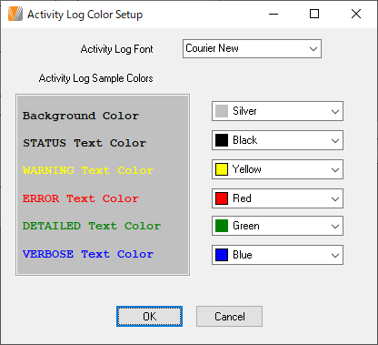

| 英語 | 日本語 |
| --- | --- |
| Activity Log Sample Colors | ログの色の見本 |
| Activity Log Font | ログの文字の種類 |
| Background Color | 背景の色 |
| STATUS Text Color | 状態の文字の色 |
| WARNING Text Color | 警告の文字の色 |
| ERROR Text Color | エラーの文字の色 |
| DETAILED Text Color | 詳細の文字の色 |
| VERBOSE Text Color | すべての文字の色 |

### 4.7 そのほかの画面

| 画面(英語) | 日本語 | 内容 |
| --- | --- | --- |
| Sent/Received Shapes | 送受信した形 | 玉形・Z データ・穴の図。印刷もできる |
| Activity Log | アクティビティログ | やりとりの記録。右クリックで Edit Job File(ジョブファイルを開く)/ Select All / Select None / Copy / Print / Clear |
| About DCS Host Simulator | バージョン情報 | |
| DCS Host Simulator Terms of Use | 利用規約 | 「I Accept the Terms of Use」(規約に同意する)に印を付けて OK。この版では出す方法が見つからない(下の説明) |

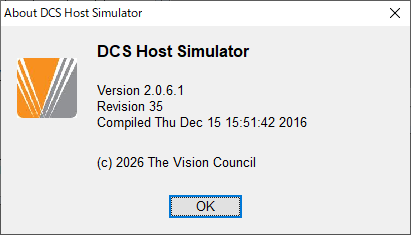

バージョン情報には、Version 2.0.6.1、Revision 35、Compiled Thu Dec 15 15:51:42 2016 と出ます。

### 4.8 マウスを乗せたときの説明(Hint)

設定の画面の項目にマウスを乗せると、英語の説明が出ます。この説明は、初めて起動したときに `DCS.INI` の `[Hints]` に書き出されます(すでにある項目は書き換えません)。

| 項目 | 英語の説明 | 日本語 |
| --- | --- | --- |
| Enable binary Mode 2 / 3 / 4 | Controls whether or not trace format 2 (3, 4) is negotiated as a valid trace format when a device initializes | 装置の初期化のとき、玉形の形式 2(3・4)を使える形式として認めるかどうか |
| Terminator Type | Indicates the end of record terminator in data packets | パケットの中で、レコードの行末に付ける記号 |
| Generate Random Request ID's | Generate random session ID's instead of using incremental numbers | 通し番号の代わりに、でたらめなセッション番号を使う |
| Send CRC | Controls whether or not CRC values are generated by the simulator and sent to the device | CRC を計算して装置へ送るかどうか |
| Send Extra REM Records | When enabled, extra REM records are sent randomly to the device | オンにすると、余分な REM をときどき装置へ送る |
| Send Superfluous Spaces | When enabled, random spaces are inserted in device records to test the device's ability to properly handle them | オンにすると、レコードに空白をでたらめに入れて、装置が正しく扱えるかを試す |
| Quote Text/Limited Data | Indiciates how to prepare limited and text records in packets | 文字列のレコードを引用符で囲むかどうか(英文の「Indiciates」はつづりの誤り) |
| DO record value when unspecified in job file | Default value for DO records when DO is not in job file | ジョブに DO がないときに送る DO の値 |
| Auto and Preset Initialization Enabled | Auto and Preset initialization are enabled if this is enabled | オンにすると、自動とプリセットの両方の初期化を使う |
| Preset Initialization Enabled | Preset initialization is enabled if this is enabled | オンにすると、プリセットの初期化を使う |
| Ignore DEF list from upload devices | When enabled, DEF records on upload devices are ignored. If not enabled, DEF records for upload devices causes an error | オンにすると、アップロード装置の DEF を無視する。オフにすると、エラーにする |
| Allow Bad CRC | When enabled, bad CRC values from the device are logged but ignored | オンにすると、装置からの CRC の誤りを記録だけして続ける |
| INFO allowed | Indicates whether a device can send INFO records to the host | 装置がホストへ INFO を送ってよいかどうか |
| Randomize INI Retrieval Order | When enabled, the order in which records in packets are returned is randomized | オンにすると、パケットの中のレコードの順番をでたらめにする |
| Retrieve Data in INI Order | When enabled, records in packets are arranged in the order in which they appear in the settings(INI) file | オンにすると、パケットの中のレコードを設定(INI)ファイルの順番に並べる |
| Confirmation Timeout | Indicates the number of seconds that may elapse between a device and host confirming receipt of a packet | パケットを受け取ったことを確かめ合うまでに待つ秒数 |
| Packet Timeout | Indicates the number of seconds that may elapse between packets being sent | パケットとパケットのあいだに待つ秒数 |
| Intercharacter Timeout | Indicates the number of seconds that may elapse between data characters sent in packets | パケットの中で、文字と文字のあいだに待つ秒数 |
| Activity Log Font | Sets the font used in the activity log | ログの文字の種類を決める |
| Background Color など(色) | Sets the background (status / warning / error / detailed / verbose) color used in the activity log | ログの背景(状態・警告・エラー・詳細・すべて)の色を決める |
| Rendezvous Port (UDP) | Indicate the port used to listen to incoming UDP requests | 装置からの UDP の呼びかけを待つポート |
| Remote Port (TCP) | Indicate the port to which a client can connect to this program | 装置がこのプログラムにつなぎに来るポート |
| Local Connection Device Addr:Port | Indicate the IP address and port number of the device to which this program should connect | このプログラムからつなぎに行く装置の IP アドレスとポート番号 |
| Response Delay (ms) | Delays the Simulator's Response to Packets | パケットへの返事をわざと遅らせる |

**利用規約の画面について**: メニューには、利用規約の画面を開く項目がありません。`hist.txt` の r26 には「規約に同意させる仕組みを足したが、The Vision Council はまだ使いたくないと言っている」とあります。この版では、この画面は表示されないものと考えられます。

---

## 5. DCS.INI の設定

`//` で始まる行は注釈です。(ここに書いた既定値は、インストールしたときの値です。)

> **注意(試して分かったこと)**: この版では、`[COMM_SETUP]` と `[LOGGING_SETUP]` の値を変えても、画面や動きは変わりませんでした。画面で変えた通信とログの設定は、別の節(`[Settings]`・`[Logging]`・`[Colors]`)に保存されます。`[PROTOCOL_SETUP]` の `APPEND_RECORD_LIST`・`INTERFACE_RECORDS_TO_SAVE`・`INTERFACE_RECORDS_TO_RETRIEVE`、`[TRACE_DATA_SUPPORT]` の `RESOLUTION_360_ENABLED` も、効いている様子が見られませんでした。5.1 と 5.5 は、ファイルの注釈の説明として残しています。画面で変えたときに保存される名前は、[留意点の一覧](notes.md) の N5 を見てください。
>
> また、画面の DTR・RTS は、`[Settings]` の値が 1 のとき「Off」、0 のとき「On」と表示されます(N6)。

### 5.1 [COMM_SETUP](シリアル通信。この版では効かない様子)

| 設定 | 既定値 | 意味 |
| --- | --- | --- |
| `PORT` | 1 | COM ポートの番号(1 なら COM1) |
| `BAUD` | 9600 | 通信速度(bps) |
| `PARITY` | 0 | 0 = なし、1 = 奇数、2 = 偶数、3 = Mark、4 = Space |
| `DATA_BITS` | 8 | データビット |
| `STOP_BITS` | 0 | 0 = 1 ビット(ふつうはこれ)、1 = 1.5 ビット(エラーになりやすい)、2 = 2 ビット |
| `DTR` | 1 | DTR 信号。1 = オン、0 = オフ |
| `RTS` | 1 | RTS 信号。1 = オン、0 = オフ |

### 5.2 [PROTOCOL_SETUP](プロトコル)

| 設定 | 既定値 | 意味 |
| --- | --- | --- |
| `CONFIRMATION_TIMEOUT` | 6 | 確認(ACK・NAK)を待つ秒数 |
| `PACKET_TIMEOUT` | 12 | パケットを待つ秒数 |
| `INTERCHARACTER_TIMEOUT` | 5 | 文字と文字のあいだを待つ秒数 |
| `INFO_ALLOWED` | 1 | 1 なら装置からの `INFO` を受け付ける |
| `EXTRA_REMARKS` | 1 | 1 なら、意味のない `REM` 行を混ぜて送る |
| `SUPERFLUOUS_SPACES_ENABLED` | 1 | 1 なら、ラベルと `=` のあいだに、ときどき空白を入れる(バイナリのレコードには入れない) |
| `TERMINATOR_TYPE` | 0 | 行末の記号。0 = でたらめ、1 = CR LF、2 = LF、3 = CR、4 = LF CR、5 = CR CR、6 = LF LF |
| `SEND_CRC` | 1 | 1 なら CRC を計算して送る |
| `ALLOW_BAD_CRC` | 0 | 1 なら、受け取った CRC の誤りをエラーではなく警告にする |
| `DO` | ? | ジョブファイルに `DO` がないときに送る値。B・R・L・N・? のどれか |
| `APPEND_RECORD_LIST` | XYZ123;XYZ456;ZZZ123 | **(この版では効かない様子)** アップロードにこの中のレコードが入っていると、ジョブを上書きせず後ろに書き足す。既定値は試し用の名前 |
| `INTERFACE_RECORDS_TO_SAVE` | DEV;DO;MESG;MID;MNAME;MODEL;OPERID;REM;SN;VEN | **(この版では効かない様子)** アップロードを保存するとき、残しておく「やりとり用のレコード」 |
| `INTERFACE_RECORDS_TO_RETRIEVE` | MESG;REM | **(この版では効かない様子)** ジョブファイルから読んで装置へ送る「やりとり用のレコード」。STATUS・HID・DO・JOB は自動で扱うので書かない |
| `IGNORE_DEF_LIST_FOR_UPLOAD_DEV` | 1 | 1 なら、アップロード装置が初期化で送る DEF 一覧を無視する。古い装置に合わせるためで、規格 3.02 には合わない |
| `QUOTE_STRINGS` | 2 | 文字列を引用符で囲むか。0 = 囲まない、1 = いつも、2 = でたらめ、3 = 交互 |

### 5.3 [INITIALIZATION_SETUP](初期化)

| 設定 | 既定値 | 意味 |
| --- | --- | --- |
| `RETRIEVE_IN_INI_ORDER` | 1 | 1 なら、初期化の一覧の順番でレコードを送る。0 ならジョブファイルに書かれた順 |
| `RANDOMIZE_INI_ORDER` | 1 | 上が 1 のとき、さらに 1 にすると順番をでたらめにする |
| `AUTO_AND_PRESET_INI_ENABLED` | 1 | 1 なら、自動の初期化とプリセットの初期化の両方を使う(下の設定にかかわらず) |
| `PRESET_INI_ENABLED` | 1 | 1 なら、プリセットの初期化を使う |
| `AUTO_INI_COUNTER` | 30 | 自動の初期化で割り当てる番号の数え始め(推測) |

ここでいう「自動の初期化」は、装置が欲しいレコードの一覧(DEF)を自分で送る方式です。「プリセット」は、装置の種類(DEV)だけを送り、一覧は `VCA_INI.INI` の決まったものを使う方式です。
TRCFMT や Z データの順番は、この設定に関係なく規格どおりに扱われます。

### 5.4 [TRACE_DATA_SUPPORT](玉形データ)

| 設定 | 既定値 | 意味 |
| --- | --- | --- |
| `MODE2_ENABLED` | 1 | バイナリ形式 2 を使う(形式 1 はいつも使える) |
| `MODE3_ENABLED` | 1 | バイナリ形式 3 を使う |
| `MODE4_ENABLED` | 1 | バイナリ形式 4 を使う |
| `Z_DATA_ENABLED` | 1 | Z データを使う |
| `UNEVEN_ENABLED` | 1 | 角度が等間隔でないデータを使う |
| `ALL_RESOLUTIONS_ENABLED` | 1 | 1 なら 1〜36000 点をすべて許す(下の個別の設定より優先) |
| `RESOLUTION_128_ENABLED` | 1 | 128 点を許す |
| `RESOLUTION_360_ENABLED` | 1 | **(この版では効かない様子)** 360 点を許す |
| `RESOLUTION_400_ENABLED` | 1 | 400 点を許す |
| `RESOLUTION_512_ENABLED` | 1 | 512 点を許す |
| `RESOLUTION_CUSTOM1`〜`4` | 0 | 0 以外にすると、その点の数も許す |
| `FRAME_CENTERING_TOLERANCE` | 50 | アップロードされた玉形の中心が、x・y それぞれどれだけずれてよいか(0.01 mm 単位。50 なら 0.5 mm)。規格 3.02 の 5.4.8 のためのもので、規格には数値が書かれていない |

### 5.5 [LOGGING_SETUP](ログ。この版では効かない様子)

**記録する内容**

`LOG_部分_詳しさ` の組み合わせで、出すかどうか(1 = 出す、0 = 出さない)を決めます。画面の Logging Options と同じです。

- 部分: `SERIAL`(シリアル)、`PACKET`(パケット)、`PARSER`(解析)、`DATABASE`(ジョブファイル)、`INI_MANAGER`(初期化)、`TEST_MANAGER`(試験)、`PROTOCOL`(プロトコル)、`GENERAL`(全体)
- 詳しさ: `STATUS`(状態)、`DETAILED`(詳細)、`VERBOSE`(すべて)、`WARNING`(警告)、`ERROR`(エラー)
- `LOG_EVERYTHING`:1 ならすべて出す

既定では、状態・警告・エラーはすべて出し、詳細はシリアルとパケットだけ、すべて(VERBOSE)はどれも出さない設定です。

**画面の色と文字**

| 設定 | 既定値 | 意味 |
| --- | --- | --- |
| `LOG_SCREEN_COLOR_STATUS` | 0 | 状態の色(黒) |
| `LOG_SCREEN_COLOR_WARNING` | 65535 | 警告の色(黄) |
| `LOG_SCREEN_COLOR_ERROR` | 255 | エラーの色(赤) |
| `LOG_SCREEN_COLOR_DETAILED` | 32768 | 詳細の色(緑) |
| `LOG_SCREEN_COLOR_VERBOSE` | 16744576 | すべての色(薄い青) |
| `LOG_SCREEN_COLOR_BACKGROUND` | 12632256 | 背景の色(灰色) |
| `LOG_FONT` | OEM_FONT | 文字の種類。OEM_FONT・SYSTEM_FONT・ANSI_FONT から選ぶ |

色の数は Windows の決まりで、青 × 65536 + 緑 × 256 + 赤 です(各 0〜255)。16 進数で書いても、保存し直すと 10 進数に変わることがあります。背景の色で上位 8 ビットのどれかを立てると、Windows の既定の背景色になります。

**HTML のログ**

`LOG_HEADER`・`LOG_TRAILER` と、`LOG_STATUS_TAG1` などのタグで、HTML にしたログの見た目を決めます。ふつうは変えなくてかまいません。

---

## 6. そのほかの設定ファイル

### 6.1 VCA_INI.INI と UserINI.INI(初期化で送るレコードの一覧)

書き方:

```
BEGINDEF=DOWNLOAD:装置の種類[:メーカー][:型番]
   レコード名
   レコード名
ENDDEF
```

- `UPLOAD`(装置から受け取る)と `DOWNLOAD`(装置へ送る)のどちらかを書く。
- 型番だけを書くときも、メーカーの区切りの `:` は要る。
- `UserINI.INI` に同じ名前(装置の種類・メーカー・型番)があれば、そちらが使われる。
- 文法のチェックはしないので、間違えないように書く。

`VCA_INI.INI` にある装置の種類:

| 記号 | 装置 | 向き |
| --- | --- | --- |
| UPL | すべて受け取る | UPLOAD |
| DNL | すべて送る | DOWNLOAD |
| TRC | フレームトレーサー | UPLOAD |
| PTG | パターン作成機 | DOWNLOAD |
| EDG | 玉摺り機(エッジャー) | DOWNLOAD |
| FBK | フィニッシュブロッカー | DOWNLOAD |
| SBK | サーフェスブロッカー | DOWNLOAD |
| GEN | 表面加工機(ジェネレーター) | DOWNLOAD |
| AGN | ほかの加工機(ラミネート) | DOWNLOAD |
| COA | コーティング装置 | DOWNLOAD |
| FSG | 前面加工機 | DOWNLOAD |
| LMD | レンズメーター | DOWNLOAD |
| INS | 検査装置 | DOWNLOAD |
| LAP | 研磨皿の供給装置 | DOWNLOAD |

`UserINI.INI` には、National Optronics の 6E(エッジャー)と 3B(フレームブロッカー)向けの例があります。

### 6.2 VCA_Records.INI と User_Records.INI(レコードの定義)

書き方:

```
種類  ラベル = データ形式;データ形式;...
```

- 種類: `interface`(やりとり用)、`device`(装置のデータ)、`both`(両方。TRCFMT・ZFMT)
- データ形式: `limited`(12 文字までの文字列)、`text`(80 文字までの文字列)、`literal`(引用符なしの短い語)、`numeric`(数値)、`integer`(整数)、`binary`(玉形のようなデータ)
- `{最小;最大}` で値の範囲を決める。`[ ]` で囲んだものは省いてよい。
- 最後が `;` なら右眼・左眼の 2 つの値を持つ。`[;]` なら、値が 1 つのとき両眼に同じ値を使う。

`User_Records.INI` は `VCA_Records.INI` のあとに読まれるので、同じラベルを書くと上書きします。試作用です。

---

## 7. サンプルジョブ

`Jobs` フォルダに 51 件あります。くわしい一覧は [jobs.md](jobs.md) にあります。

| ジョブ | 玉形 | 何を試すか |
| --- | --- | --- |
| 9001〜9026 | 800 点、Z データつき(200 点) | 縁の加工の種類(ETYP:1 = ヤゲン、2 = リムレス、3 = 溝掘り)、ヤゲンの位置(BEVP)、穴あけ(DRILL)などの組み合わせ |
| 9027〜9050 | 400 点、Z データなし | 度数(SPH −20〜+12)やレンズの種類(BI = 二重焦点、PR = 累進、SV = 単焦点、AS = 非球面 など) |
| 9101 | 1000 点、両眼共通のパターン(`TRCFMT=1;1000;E;B;P`) | 新しい書き方の穴あけ(DRILLE)4 個 |

**注意**: 9004〜9025 の 22 件は、ファイルに書かれた HBOX・VBOX(玉型の幅と高さ)が、実際の玉形と合いません。ジョブを作るときに数値を使い回したためと思われます。寸法の正解として使わないでください。

---

## 8. ログによく出る言葉

| ログ(英語) | 意味 |
| --- | --- |
| DCS Host Simulator starting | 起動した |
| Settings from INI files loaded | 設定ファイルを読み込んだ |
| Serial port COMn opened OK | COM ポートを開いた |
| No port indicated in the settings | 使える COM ポートがない。`PORT=0` のときのほか、COM ポートのないパソコンでも出る |
| Remote Connection - TCP listening on port … | TCP で装置からの接続を待っている |
| Autoconnect Connection - UDP listening on port … | UDP で装置からの呼びかけを待っている |
| Connected to device with IP address … | 装置とつながった |
| Disconnected from IP device / Closed connection to device | 装置との接続が切れた |
| Received from device / Sent to device | 装置から受け取った / 装置へ送った |
| ACK received / NAK received | 装置が受け取れた / 受け取れなかった |
| Sending ACK to device / Sending NAK to device | 装置へ「受け取れた」/「受け取れなかった」を返した |
| Responded to device's request to initialize | 装置の初期化に答えた |
| Responding to device's initialization for device type … | 装置の種類(プリセット)で初期化に答えている |
| Responding to device's definition | 装置が送った一覧(DEF)で初期化に答えている |
| 2nd REQ=INI - Resetting back to initial state | もう一度初期化が来たので、最初の状態に戻した |
| INI NUMBER … NOT FOUND. (RE)INITIALIZATION IS REQUIRED | 初期化の番号が見つからない。初期化をやり直す必要がある |
| JOB NOT FOUND / … not found for job | ジョブファイルが見つからない |
| Job number not found in request packet | 要求に JOB がない |
| Upload request to receive job | 装置がデータを送ってこようとしている |
| Sending positive status to device to upload data | 送ってよいと答えた |
| Upload data stored to file | 受け取ったデータをファイルに保存した |
| Responded to device's TIM (time) request | 装置に時刻を答えた |
| Calculated CRC=… does not match received CRC=… | CRC が合わない(データが壊れた可能性) |
| Required RS character missing | パケットの区切り文字(RS)がない |
| Unexpected character | 思いがけない文字を受け取った |
| No trace formats proposed are acceptable | 装置が示した玉形の形式に、どれも対応していない(Trace Data の設定を見直す) |
| Check configuration for supported TRCFMTs. | 対応する玉形の形式の設定を確かめる |
| An upload device is providing a definition list during initialization. | アップロード装置が初期化で一覧を送ってきた(`IGNORE_DEF_LIST_FOR_UPLOAD_DEV` の設定で扱いが変わる) |
| Invalid auto-initialization. DEF/ENDDEF do not match | 初期化の一覧の始まり(DEF)と終わり(ENDDEF)が合わない |
| No DEF and no DEV supplied. | 初期化に一覧も装置の種類もない |
| DEVICE NOT FOUND THROUGH WHICH TO SEND DATA | 送る相手の装置がつながっていない |
| Unknown request packet | 知らない要求を受け取った |

---

## 9. 入手について

DCS Host Simulator は、The Vision Council のウェブサイトの「Standards for Communication」のページにある「Data Communication Standard Simulator Software」から、申し込みの欄(名前・会社・メール)に記入して入手できます。

The Vision Council の会員でなくても、DCS Host Simulator を入手して使うことができます。2026 年 10 月に The Vision Council へ問い合わせ、確認しました。

- [Standards for Communication(The Vision Council)](https://thevisioncouncil.org/members/standards-communication)

DCS Host Simulator と DCS 規格の著作権は The Vision Council にあります。このマニュアルは個人が調べて書いた非公式のもので、The Vision Council が作ったり確かめたりしたものではありません。画面の画像は、使い方を説明するために載せています。

## 謝辞

問い合わせに丁寧に答えてくださった The Vision Council の皆さまに、心より感謝いたします。
